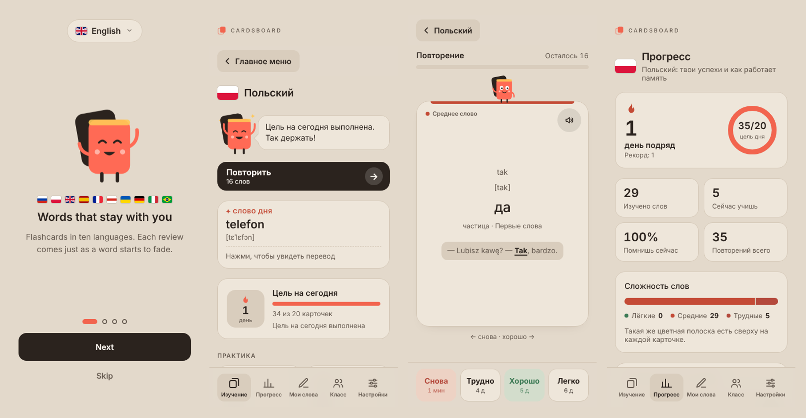
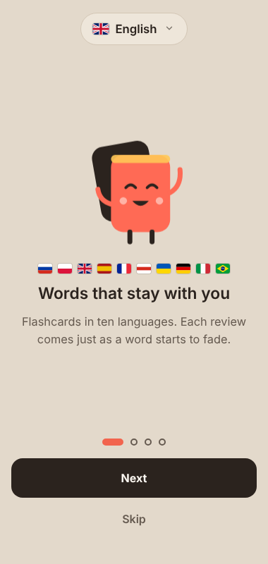
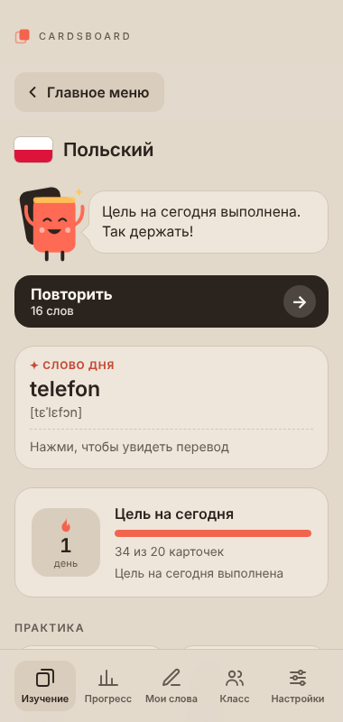
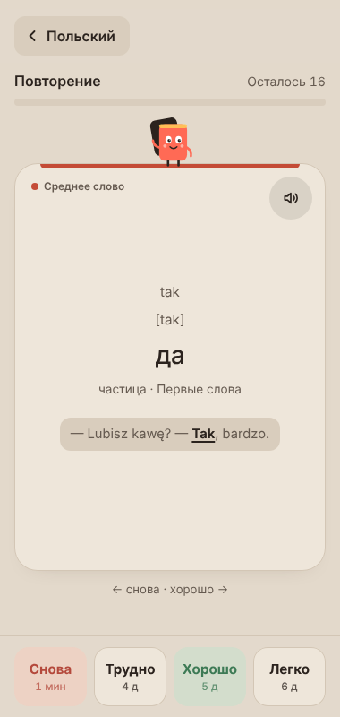
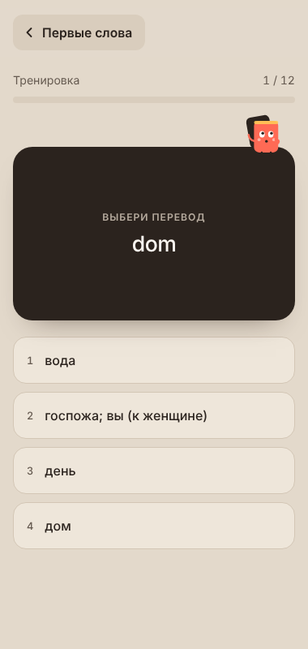
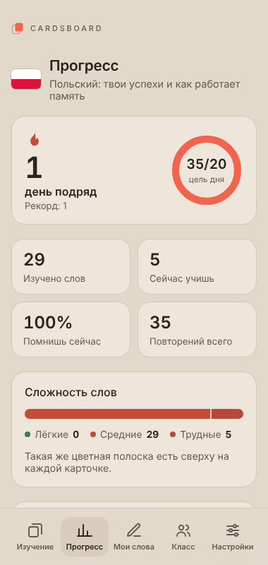
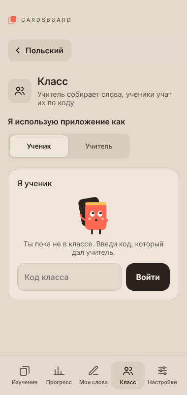

# Cardsboard

**Flashcards for learning words in 10 languages — from any of them to any other.**

Pick the language you speak, pick the language you want to learn, and study ~1,600 everyday words with spaced repetition. Reviews come back right when a word starts to fade.

## Features

- **10 languages, 90 courses.** Polish, Russian, English, Spanish, French, Belarusian, Ukrainian, German, Italian, Portuguese (Brazil). Any language can be learned from any other, and the whole interface is translated into all ten.
- **1,597 words in 48 topics on 3 levels.** They go from first words to opinions and discussions, roughly A1 to B1. Every word has a translation, an IPA transcription with stress, and an example sentence.
- **Spaced repetition (FSRS).** Swipe right if you knew the word, swipe left if you didn't. The algorithm schedules the next review.
- **Practice.** Exercises mix choosing the translation, typing the word, listening and filling the word into a sentence. Practice only uses words you have already started.
- **Final test per topic.** The topic is passed with at most one mistake.
- **Placement test.** 18 words, about two minutes, sets your starting level.
- **Progress.** Daily goal, streak, activity heat-map, a 7-day review forecast and word difficulty.
- **Pronunciation.** Uses the best voice on your device (Natural / Neural / Premium). A second tap plays the word slower.
- **Your own words.** Add custom word pairs; they are learned the same way as the topics.
- **Class mode.** A teacher collects words into a class and students join with a code. The teacher sees each student's progress.
- **Light and dark theme**, mobile-first layout, Karti the mascot.

## Run it

It is a single self-contained file, so there is nothing to build or install.

- **Locally:** open `index.html` in a browser.
- **GitHub Pages:** go to *Settings → Pages → Deploy from a branch → `main` / root*. The app will be live at `https://<your-username>.github.io/<repo-name>/`.

Progress is saved in the browser (`localStorage`).

> **Note:** class mode needs a shared database. It works in the version hosted on claude.ai. On GitHub Pages or locally, the Class tab shows a notice and everything else works normally.

## Method

- Forgetting curve — Ebbinghaus, 1885
- Spacing effect review — Cepeda et al., 2006
- FSRS scheduling algorithm — Ye et al., 2022
- Retrieval practice — Roediger & Karpicke, 2006
- Interleaving — Kornell & Bjork, 2008; Taylor & Rohrer, 2010
- Desirable difficulties — Bjork & Bjork, 2011

## Tech

Vanilla HTML, CSS and JavaScript in one file, with no framework and no build step at runtime. Speech uses the Web Speech API. Fonts are Onest and Unbounded (Google Fonts).

## Screenshots

| Intro | Home | Card |
|---|---|---|
|  |  |  |
| **Practice** | **Progress** | **Class** |
|  |  |  |

## Author

Matsvei Vialkouski
